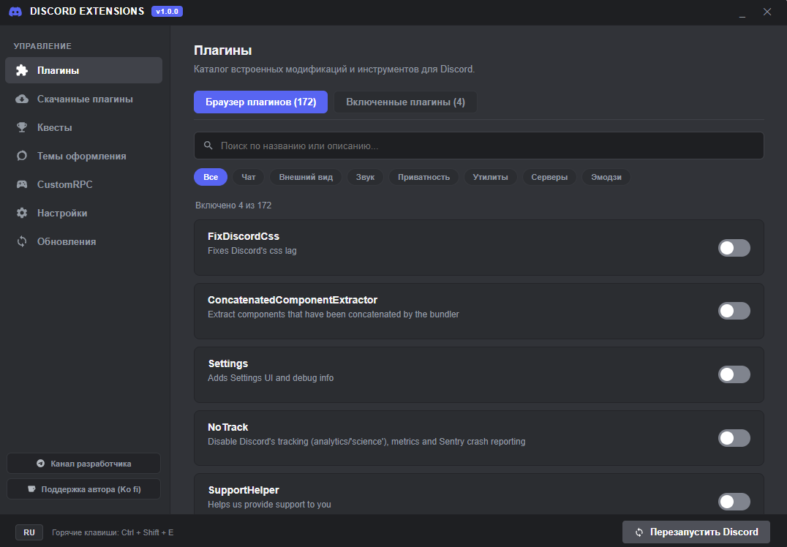
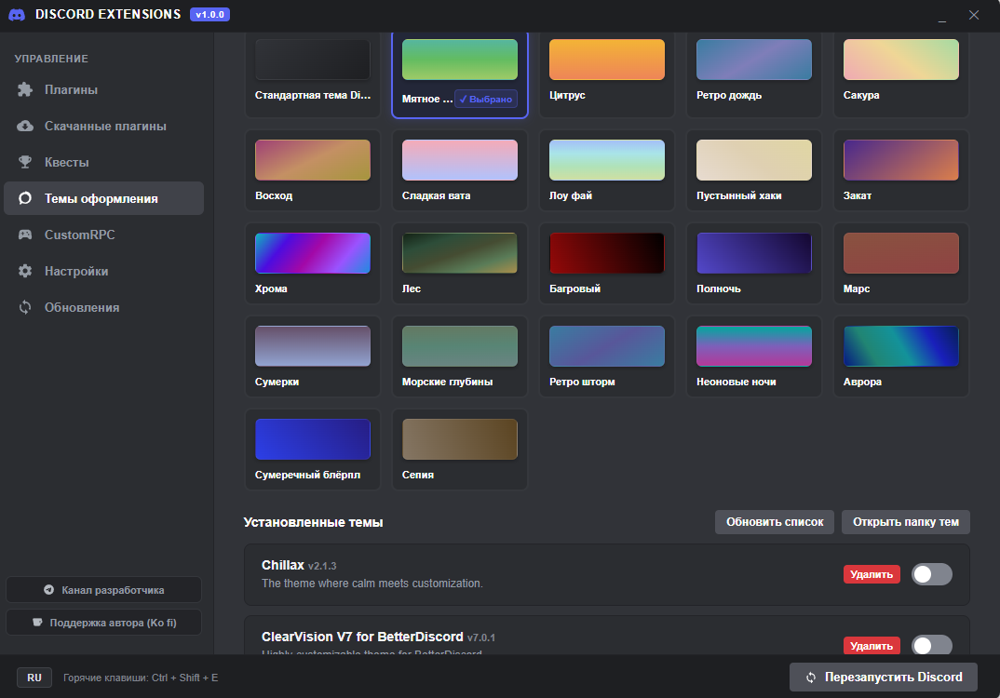
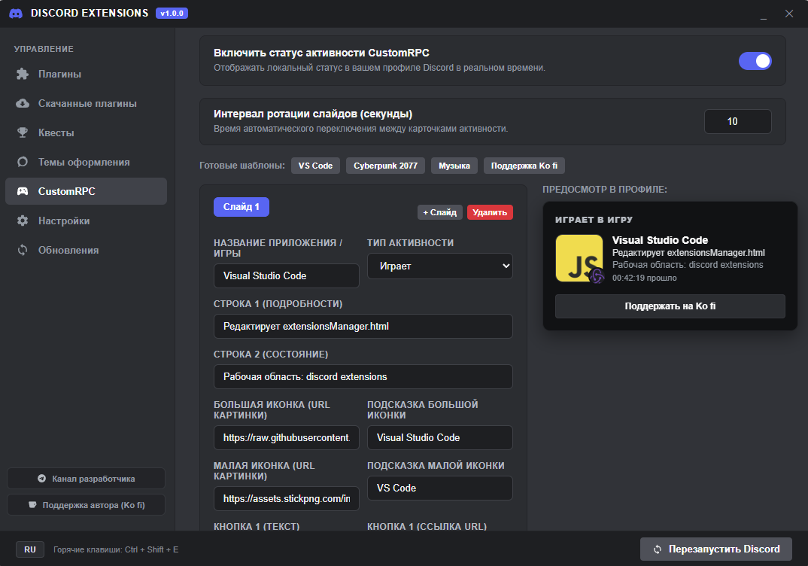

# Discord Extensions

  
  
  
  

Быстрая и легкая модификация десктопного клиента Discord со встроенным каталогом плагинов, коллекцией градиентных и кастомных тем оформления, автоматическим сбором квестов Discord, настраиваемым Rich Presence и удобным менеджером управления.

Клиент работает плавно, без просадок частоты кадров, лишней рекламы и скрытой фоновой аналитики.

## Скриншоты интерфейса

### Вкладка Плагины
Каталог плагинов с быстрым поиском, фильтрацией по категориям и моментальным включением нужных инструментов.

### Вкладка Темы
Полная коллекция официальных градиентных тем Nitro, доступных без подписки, а также поддержка пользовательских стилей CSS.

### Вкладка Custom RPC
Создание персонализированных игровых статусов в профиле с поддержкой ротации нескольких слайдов.

## Основные возможности

### Каталог плагинов
* Обширный каталог расширений с удобным разделением по категориям: Чат, Внешний вид, Звук, Приватность, Утилиты, Серверы и Эмодзи
* Мгновенный поиск по названию или описанию
* Быстрое переключение между полным списком и только активными плагинами
* Поддержка добавления сторонних пользовательских плагинов

### Нативные градиентные темы Discord
* Полная коллекция из 22 официальных градиентных тем Nitro: Мятное яблоко, Цитрус, Ретро шторм, Неоновый закат, Полуночные сумерки, Сакура и многие другие
* Работают нативно через встроенный движок Discord без необходимости покупать подписку Nitro
* Надежное сохранение активной темы при перезапуске клиента, холодном старте и синхронизации с облаком
* Поддержка пользовательских тем CSS и моментальное переключение стилей

### Автоматические квесты Discord
* Встроенный виджет отслеживания прогресса и получения наград за задания Discord
* Фоновое автоматическое выполнение и сбор наград без рутинных действий
* Адаптивная цветовая гамма виджета под выбранную тему оформления

### Настраиваемый Rich Presence (Custom RPC)
* Создание персонального статуса активности в профиле: название, описание, детали, время
* Большие и малые изображения с подсказками
* Кликабельные кнопки со ссылками на ваши ресурсы
* Ротация нескольких карточек активности по таймеру

### Настройки интерфейса
* Плавающая кнопка быстрого доступа с возможностью размещения в заголовке окна или в углах экрана
* Горячая клавиша Ctrl + Shift + E для быстрого вызова панели
* Двуязычный интерфейс с автоопределением русского или английского языка

### Автоматическое обновление
* Проверка обновлений в реальном времени через GitHub API
* Автоматическая загрузка свежих файлов в фоновом режиме
* Удобная кнопка перезапуска прямо в окне менеджера

## Быстрый старт

### Установка
1. Скачайте архив репозитория через кнопку Code, затем Download ZIP и распакуйте
2. Закройте клиент Discord
3. Запустите install.bat (или правой кнопкой по install.ps1 и выберите Выполнить с помощью PowerShell)
4. Скрипт сохранит резервную копию, установит файлы расширения и запустит обновленный клиент

### Управление
* Кнопка на панели: нажмите на плавающую иконку расширения в окне Discord
* Горячая клавиша: нажмите Ctrl + Shift + E для открытия менеджера расширений
* Консоль разработчика: F12

### Удаление
Для полного возврата к стандартному состоянию:
1. Запустите uninstall.bat
2. Скрипт восстановит оригинальный файл загрузки и очистит файлы модификации

## Сообщество и поддержка
* Официальный Telegram канал разработчика: https://t.me/KreziBro_dev
* Поддержать развитие проекта на платформе Ko fi: https://ko-fi.com/krejzibro

## Лицензия
Проект распространяется под лицензией MIT. Подробности в файле LICENSE.